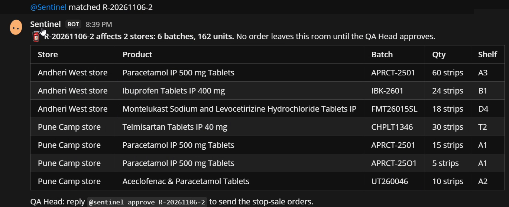
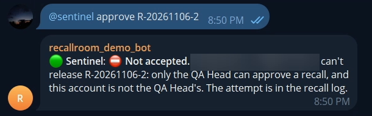
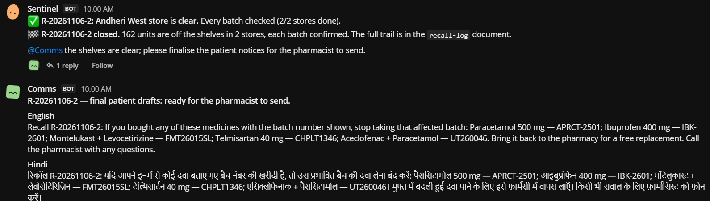

# RecallRoom

**When a drug batch fails a government quality test, every pharmacy store that stocks it pulls it off the shelf, and a person signs off at every step.**

RecallRoom is a recall desk for a pharmacy chain, built on [Switch](https://github.com/sandbox-quantum/switch). Three AI agents from three vendors work in the chat rooms the chain already uses, together with the people who are accountable:

- **sentinel:** our own Java agent, on Switch's raw agent protocol.
- **matcher:** Claude Code.
- **comms:** Codex.
- **store-runner:** Claude Code.
- **People:** a QA Head at HQ, and store managers on Telegram and Mattermost.

> Built for the WeMakeDevs × DevTools Academy **Flip the Switch** hackathon (Nov 4–7, 2026), Track 01: Best Business Workflow.

---

## The problem

India's drug regulator, CDSCO, publishes a monthly list of drug samples that failed testing ("Not of Standard Quality") or were spurious. **The September 2026 list has 330 batches**, among them paracetamol, ibuprofen, telmisartan and montelukast. The US FDA's recall feed listed 131 drug recalls in September and October alone.

At a pharmacy chain, what happens next is mostly nothing:
- The list arrives as a web table.
- Nobody matches it against stock in each store.
- Nobody confirms the strip is physically off the shelf.
- Patients who already bought the batch are never told.

## What RecallRoom does

```
 CDSCO / openFDA ──▶ sentinel ──▶ #recall-hq ──▶ matcher (Claude Code) ── impact table
                                     │               └──▶ comms (Codex) ── supplier + patient drafts
                                     │
                     QA Head: "@sentinel approve R-…"   ◀── the only way an order leaves HQ
                                     │                      (checked in code, against the QA Head's own account)
                                     ▼
            #store-pune (Mattermost)       Telegram "store" group (Andheri, on the manager's phone)
                     │                                  │
               store-runner (Claude Code) ── asks for a shelf photo, reads the batch number,
                                              confirms or asks for a recheck ──▶ sentinel
                                                                                    │
                                     recall-log document ◀──────────────────────────┘ (audit trail)
```

1. **Alert.** Sentinel reads CDSCO's monthly lists (or openFDA) and opens recall `R-20261104-1` in `#recall-hq` with every flagged batch.
2. **Impact.** The matcher runs `tools/match.mjs` against each store's stock. It posts the impact table plus judgement, such as "APRCT-25O1 has a letter O; check the strip on shelf A1". Then it hands back to sentinel.
3. **Drafts.** Comms drafts supplier return notes, and patient messages in English and Hindi. It sends nothing.
4. **Approval.** Nothing leaves HQ until the **QA Head** writes `@sentinel approve R-…`. Sentinel checks this **in code**:
   - the Switch sender id is the QA Head's account (a display name can be changed by anyone; the id can't);
   - the message is not posted by an agent on someone's behalf;
   - it was written in HQ;
   - the recall is waiting for approval.
   
   Every refused attempt goes into the log.
5. **Stop sale.** Sentinel sends an order into each affected store's room. On Telegram, the manager replies with a shelf photo. The store runner reads the batch number off the strip and confirms each batch, or asks for a recheck.
6. **Close.** When every batch in every store is photo-checked, sentinel closes the recall, and comms marks the patient message ready for the pharmacist. The `recall-log` room document is the full audit trail.

## See it run

From the recorded test recall `R-20261106-2`, on CDSCO's real September 2026 list:

**The impact table:** the matcher found 6 batches and 162 units across two stores, including the `APRCT-25O1` stock-entry typo.



**An approval from the store's Telegram is refused:** the check compares the sender's Switch id, not their name.



**The recall closes** once every batch in both stores is confirmed by a photo. Comms then posts the final patient message in English and Hindi.



## How Switch is used (and why it can't work without it)

| Switch feature | What RecallRoom does with it |
|---|---|
| **Rooms on two messaging apps** | HQ and one store on Mattermost; another store on **Telegram**, where staff already are. One workflow spans both. |
| **Agents from three vendors** | sentinel (our own Java agent, `connector_type: external`), matcher and store-runner (Claude Code), comms (Codex). |
| **The agent protocol** | Sentinel is a real protocol client: registration, a WebSocket with ping/pong and resume-from-cursor, and operations (`connect_to_room`, `list_rooms`, `create_room_document`, `update_room_document`). See [`sentinel/…/switchapi`](sentinel/src/main/java/in/yusr/recallroom/switchapi). |
| **Templates** | [`switch/recallroom.template.yaml`](switch/recallroom.template.yaml) creates all of this in **one run**: three managed agents, a room group (`recall-hq`, `store-pune`), roles (`impact-analyst`, `notice-writer`), the `recall-sop` document, room links, room briefs and kickoff messages. [`recall-store.template.yaml`](switch/recall-store.template.yaml) adds a store. |
| **Roles** | Agents take a role at kickoff (`🎭 assumed the impact-analyst role`). |
| **Room documents** | `recall-sop` (the procedure every agent reads) and `recall-log` (the audit trail, kept by sentinel). |
| **Links between rooms** | Each store room "reports to" HQ, and HQ lists its stores. |
| **Handoffs between agents** | sentinel → matcher → sentinel + comms → (QA Head) → sentinel → store-runner → sentinel, all by mentions in the rooms. |
| **Who can address an agent** | matcher and comms answer only their owner's people and agents; store-runner answers anyone in its store rooms. |
| **Sender identity** | Every message carries the sender's Switch participant id, which is tied to the account and can't be changed by renaming. The approval gate and the agent reports are checked against it. |
| **Photo attachments** | A store manager's Telegram photo reaches the Claude Code store runner, which reads the batch number off the strip. |

Take Switch away and nothing is left: no rooms, no agents talking to each other, no Telegram, no photos, no identity to gate the approval on.

## Safety decisions

- **The approval is code, not a prompt.** [`ApprovalGate`](sentinel/src/main/java/in/yusr/recallroom/recall/ApprovalGate.java) compares exact Switch ids. An LLM can be talked into anything; `String.equals` can't. During testing, the comms agent refused on its own to post an approval, but RecallRoom doesn't rely on that.
- **Helper agents are pinned.** The matcher's and store runner's reports count only from their own Switch ids, only in their own rooms, and only at the right step ([`RecallService`](sentinel/src/main/java/in/yusr/recallroom/recall/RecallService.java)).
- **Orders can't be misrouted.** Store rooms resolve by exact name. If a name is ambiguous, nothing is sent.
- **A store clears batch by batch.** `APRCT-2501` and `APRCT-25O1` are two batches, and each needs its own photo.
- **No silent loss.** Every message to sentinel is logged. After any reconnect, sentinel reads room history and flags anything sent to it that it never received, asking for it to be resent rather than acting on a replay.
- **Agents draft; people decide.** Comms never sends to customers; the store runner never releases stock.
- 19 unit tests cover the gate, room routing, batch matching and FDA lot parsing: `cd sentinel && ./mvnw test`.

## Repository

| Path | What it is |
|---|---|
| `sentinel/` | The Java 21 / Spring Boot 4 agent: feeds ([CDSCO](sentinel/src/main/java/in/yusr/recallroom/feeds/CdscoClient.java), [openFDA](sentinel/src/main/java/in/yusr/recallroom/feeds/OpenFdaClient.java)), the [Switch protocol client](sentinel/src/main/java/in/yusr/recallroom/switchapi), and the [recall workflow](sentinel/src/main/java/in/yusr/recallroom/recall). |
| `tools/match.mjs` | The matcher's tool: flagged batches × store stock → `data/matches/<recall>.json` and a Markdown table. |
| `inventory/` | Each store's stock (CSV) and which room the store uses (`stores.json`). |
| `switch/` | The Switch templates. |
| `deploy/` | systemd unit, env example, demo reset script. |
| `docs/` | [Architecture](docs/architecture.md), [demo script](docs/demo-script.md), labelled demo props. |

## Run it yourself

You need:
- A Switch server with Switch Console. Console's "Run or join a server on a remote host" works well.
- A Linux or macOS machine for the agents, with Claude Code and Codex signed in. Console on Windows can't run agents locally.
- Node 20+ and a Java 21 JDK on that machine (a JRE runs sentinel but can't build it).

```bash
git clone <this repo> ~/recallroom && cd ~/recallroom/sentinel && ./mvnw package   # builds target/sentinel.jar
```

1. **Register sentinel.** In the Switch Gateway, go to **API Keys → Create Registration Key**. Put the key in a one-line file, copy [`deploy/sentinel.env.example`](deploy/sentinel.env.example) to `~/.config/recallroom/sentinel.env`, and fill it in. Then:
   ```bash
   sudo cp deploy/sentinel.service /etc/systemd/system/recallroom-sentinel.service
   sudo systemctl enable --now recallroom-sentinel
   ```
   Sentinel registers once and keeps its identity in `data/` (ignored by git); you can delete the key file afterwards. The unit and the env example assume user `ubuntu` and the repo at `~/recallroom`; change the paths if yours differ.
2. **Create everything else.** In Switch Console, use **Import template** with [`switch/recallroom.template.yaml`](switch/recallroom.template.yaml) and run it, choosing the agents' machine and `repo_dir`.
3. **Set the QA Head.** In `#recall-hq`, send `@sentinel whoami` from the QA Head's account, put that id in `RECALLROOM_QA_HEADS`, and restart sentinel.
4. **Add a Telegram store (optional).**
   - Create the group in Telegram and add your Switch bot.
   - In the group, send `!invite-agent @store-runner` and `!invite-agent @sentinel`.
   - Put the group's title in `inventory/stores.json`.
5. **Try it:** in `#recall-hq`, send `@sentinel scan Sep-2026`.

### Commands (to sentinel, in a room)

| Message | Who | What happens |
|---|---|---|
| `@sentinel scan latest` / `scan Sep-2026` / `scan openfda 30` | anyone in HQ | Opens a recall from that list. Add `again` to repeat a list that's already covered. |
| `@sentinel approve R-…` | **QA Head only**, in HQ | Sends the stop-sale orders. |
| `@sentinel accept R-… store=<id> <batch>` | **QA Head only**, in HQ | Settles a "probable" line, after the store runner asks for a recheck, as a typo in our stock records. |
| `@sentinel status [R-…]` | anyone | Shows recalls and their stores. |
| `@sentinel whoami` | anyone | Shows your Switch sender id. |
| `@sentinel matched R-…` | matcher (pinned) | Hands over the impact table. |
| `@sentinel confirm R-… store=<id> <batch> …` / `recheck …` | store-runner (pinned), in that store's room | Reports one batch. |

## Data, honestly

- **Flagged batches are real.** They come live from CDSCO's public NSQ and spurious lists (`cdscoonline.gov.in/CDSCO/viewPublicNSQDrug`) and from openFDA's drug enforcement API.
- **Store stock is sample data.**
  - Rows that match real flagged batches carry the manufacturer named in CDSCO's list.
  - Every other row is labelled "Demo Generics (sample stock)".
  - `APRCT-25O1` is a deliberate stock-entry typo, to show "probable" matching.
- **The strip images in `docs/demo-props/` are drawn props**, marked "DEMO PROP". Real phone photos work the same way.

## Built during the hackathon

- **Built from Nov 4:** all code, templates, agents, rooms and inventory in this repository. The git history shows it.
- **Set up before Nov 4, as Day 0 environment checks:**
  - the Switch server install on a cloud VM;
  - the Mattermost and Telegram connections;
  - a throwaway protocol probe.
  
  The test agents and rooms from those checks were deleted before the build started.

Reused, as the rules allow: CDSCO row parsing and batch-number normalisation from the author's earlier project, DawaGuard.

## Licence

Apache-2.0
