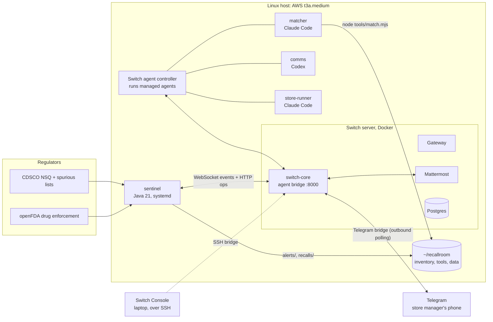

# Architecture

## Where things run



The VM exposes **only SSH**. Switch, Mattermost and the Gateway are bound to the host's loopback, and Switch Console reaches them through its SSH bridge. Telegram works without any inbound port, because Switch polls Telegram.

## One recall, message by message

```mermaid
sequenceDiagram
    autonumber
    participant Q as QA Head (Mattermost)
    participant S as sentinel (Java)
    participant M as matcher (Claude Code)
    participant C as comms (Codex)
    participant R as store-runner (Claude Code)
    participant T as Store manager (Telegram)

    Q->>S: @sentinel scan Sep-2026
    S->>S: fetch CDSCO list, write data/alerts/R-….json
    S->>M: 🔔 R-… opened, @matcher check stock
    M->>M: node tools/match.mjs → data/matches/R-….json
    M->>Q: impact table + judgement
    M->>S: @sentinel matched R-…   (pinned id, HQ, state MATCHING)
    M->>C: @comms draft notices
    S->>Q: 🧯 affects N stores, waiting for the QA Head
    C->>Q: supplier notes + patient messages (drafts)
    Q->>S: @sentinel approve R-…
    S->>S: ApprovalGate: sender id == QA Head, not on behalf of, in HQ, awaiting approval
    S->>R: 🛑 STOP-SALE ORDER (in each store's room)
    R->>T: move to quarantine, reply with a photo
    T->>R: 📷 (reply with photo)
    R->>R: read the batch number on the strip
    R->>S: @sentinel confirm R-… store=andheri APRCT-2501 …   (pinned id, store room, order open)
    S->>Q: 📸 progress; ✅ store clear; 🏁 recall closed
    S->>S: update the recall-log document
```

## Sentinel inside

| Package | Role |
|---|---|
| `switchapi` | The agent protocol. `SwitchApi` handles registration, posting and operations. `SwitchSocket` keeps one WebSocket over every room: it sends pongs straight from the listener thread so slow work can't starve the 2 s heartbeat, reconnects with the same `connection_id` from the last cursor, and stops on `taken_over`. |
| `feeds` | CDSCO monthly NSQ and spurious tables; openFDA enforcement reports, with lot numbers parsed out of free-text `code_info`; batch-key normalisation. |
| `recall` | `RecallService` routes room messages to steps. `ApprovalGate` is the code-level release check. `RecallStore` holds JSON files shared with the matcher. `RecallLog` renders the audit document. |

Plain files in `data/` are the hand-off between the Java agent and the Claude Code agent. `cat data/matches/R-….json` shows exactly what sentinel will send to stores.

## Trust boundaries

| Input | Accepted from | Checked how |
|---|---|---|
| `approve R-…` | QA Head | Exact sender id in `RECALLROOM_QA_HEADS`, `on_behalf_of` is null, HQ room, state `AWAITING_APPROVAL` |
| `matched R-…` | matcher | Agent id (`@switch-agent-…`), pinned on first valid report, HQ room, state `MATCHING` |
| `confirm` / `recheck` | store-runner | Agent id (pinned), the room the order was sent to, order open, whole-token batch match |
| `scan`, `status`, `whoami` | anyone in sentinel's rooms | Read-only, or opens a recall, which still needs the QA Head |
